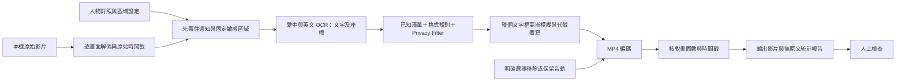

# 進階設定與命令列（手動模式）

將螢幕錄影中的敏感文字做柔化高斯模糊，將已知受測者姓名換成固定代號，並模糊使用者圈選的通知區域。整合 EasyOCR（繁體中文／英文）、OpenAI Privacy Filter 與影片解碼／編碼；資料在本機處理。

v0.1.2 使用原畫面色彩產生高斯模糊（Gaussian blur），半徑依區域尺寸介於 24–80 像素，並在區域外 16 像素內柔化邊緣，呈現接近參考截圖的柔霧外觀。敏感區域內部套用完整模糊強度；人物 A／B／C 代號以有描邊的白字顯示。既有設定檔與執行命令可繼續使用。

模糊會保留概略色彩及低頻影像資訊，無法保證不可還原。處理帳密、身分證等內容時，公開前仍需逐段確認不可辨識；本版不宣稱達成不可逆的資料移除。

從舊版更新時，保留既有 `models/` 與私人設定，安裝新版程式後重新處理影片。請使用新的輸出檔名，例如 `results/redacted-blur.mp4`；程式不會覆寫既有影片。

## 1. 功能與邊界

| 項目 | 此版行為 |
|---|---|
| 姓名代號 | 依你提供的姓名／別名對照，固定替換為受測者 A、B、C；也可自行指定 A先生、B小姐，不推測性別。另可圈選「姓名區域＋指定代號＋時間」，不依賴 OCR。 |
| 帳密、身分證、住址 | 已知字串＋格式規則＋Privacy Filter；帳密表單建議再圈選固定遮罩區域，避免 OCR 漏字。 |
| 私人通知 | **整個圈選區域**在設定時間內保持遮罩；不會自動辨識所有通訊軟體或追蹤移動視窗。通知換位置時需增加或調整區域。 |
| 每個畫面 | 不抽樣；只有像素完全相同的受保護畫面會重用前次 OCR 結果。 |
| 音軌 | 必須選擇全部移除 `drop` 或原樣保留內容 `keep`；**沒有語音個資辨識、消音或變聲**。 |
| 輸出 | H.264 MP4＋不含 OCR 原文的 JSON 報告；不複製字幕軌、資料軌與原始檔案自訂標籤。 |

這是可執行的專題第一版，不是完全匿名化保證。OCR 漏字、中文姓名、陌生帳號與不在圈選範圍的通知都可能漏遮。既有文字實測曾漏掉兩筆中文姓名，所以已知受測者清單與人工檢查是必要步驟。此版面向無旋轉標記的螢幕錄影，保留畫面時間戳；不支援的時間戳或旋轉格式會停止處理。

## 2. 安裝與準備模型

先安裝 [Python 3.11 或 3.12](https://www.python.org/downloads/) 與 [Git](https://git-scm.com/downloads)。解壓縮本專案後，在專案資料夾開啟 Terminal。Privacy Filter 使用 CPU，OCR 在支援的 Mac 可自動使用 Metal GPU；不需要 CUDA、OpenAI API 金鑰或 Hugging Face 登入。

macOS／Linux：

```sh
sh install.sh
source .venv/bin/activate
vpf prepare-models
```

如果 `python3` 不是支援版本，可指定已安裝的 Python：

```sh
VPF_PYTHON=python3.11 sh install.sh
```

Windows PowerShell（不需要啟用虛擬環境）：

```powershell
py -3.11 -m venv .venv
.\.venv\Scripts\python.exe -m pip install -c constraints-tested.txt .
.\.venv\Scripts\vpf.exe prepare-models
```

也可在 PowerShell 中執行隨附的 `install.ps1`。若系統限制腳本執行，直接用上面的三行命令，不需要改系統執行政策。

第一次準備會下載約 2.8 GB 的官方 Privacy Filter 權重，以及 OCR 模型與分詞器。請保留足夠空間容納套件、權重、輸出及暫存影片。權重不在分享壓縮檔內；準備完成後，影片處理不需要遠端推論服務。`models/` 預設放在目前資料夾；之後應在同一資料夾執行，或使用 `--models` 指定位置。

已在 macOS Apple Silicon、Python 3.11 實測。Windows／Linux 提供安裝流程，尚未在這兩個作業系統實測。詳見 `VALIDATION.md`。

## 3. 先跑虛構示範，再處理自己的影片

建立 3 秒的虛構影片。內容包含兩位受測者、電子郵件、身分證格式字串、地址、一位未列入對照表的英文姓名，以及僅出現一個畫面的通知與密碼：

```sh
vpf make-demo --output-dir demo
vpf redact demo/synthetic-input.mp4 --config demo/config.synthetic.json --output results/demo-redacted.mp4 --audio drop
```

Windows 將 `vpf` 替換成 `.\.venv\Scripts\vpf.exe`。這份示範的所有資料均為虛構；它用於驗證流程，不能當作整體辨識率。

處理自己的影片：

輸入可指定任意本機影片路徑；以下 `private/` 只是建議的私人資料目錄，不需要搬動既有影片。

1. 建立 `private/` 資料夾，將影片放入，例如 `private/input.mp4`。
2. 執行 `vpf config-editor`，用瀏覽器開啟產生的 `config-editor.html`。選擇影片、暫停後拖曳圈選所有可能出現通知的位置，以及帳密等敏感表單欄位。
3. 填入受測者姓名／暱稱／英文名及固定代號，再填入已知帳號、住址與必須遮住的字串。對已知姓名欄位再圈選「固定姓名區域＋人物代號」，填入與人物清單一致的代號，依出現時間分段；這能防止中文姓名 OCR 漏字。匯出為 `private/config.private.json`。
4. 執行下列命令，先處理一段短片並人工檢查。此例會移除全部音軌。

```sh
vpf inspect private/input.mp4
vpf redact private/input.mp4 --config private/config.private.json --output results/redacted.mp4 --audio drop
```

確定要保留所有原始說話內容時，將 `--audio drop` 換成 `--audio keep`。`keep` 不會清除口頭說出的姓名或帳密，也不會改變說話者聲音；保留音訊會重新編碼為 AAC。

查看 `results/redacted.report.json` 的處理畫面數與遮罩統計，再檢查影片所有敏感片段。遮罩不會因報告產生就自動通過驗收。未設定通知區域時程式會停止；只有確定影片不需要遮通知，才使用 `--allow-no-notification-zone`。

## 4. 設定與資料流



設定檔的 `rect` 為 `[左, 上, 右, 下]` 四個 0–1 比例值，對應完整影片畫面。`start`／`end` 為相對首畫面的秒數，採開始包含、結束不包含；`end: null` 表示到片尾。通知區域可整段遮罩，不依賴個資分類結果。帳密標籤會擴大保護右側與鄰近下方，但不同表單排列仍應直接圈選。

固定代號只依設定對照，不會自行判定不同暱稱是否同一人。OCR 曾在虛構影片中將「王小明」漏讀成「王明」且給出高信心，所以已知姓名欄位應使用固定姓名區域；同一位置若先後出現不同人物，分別設定時間及代號。為避免殘留字元，偵測到一個敏感字串時會遮住其整個 OCR 文字框，因此同框的非敏感內容也可能消失。低信心的 OCR 框預設一併遮罩。

`private/`、模型與結果不應包進程式分享檔。設定本身含原始姓名／帳密，應留在你自己的電腦。程式不將 OCR 原文、命中的個資或私人對照表寫入結果報告；瀏覽器設定頁不發送網路請求。

## 5. 測試、來源與分享

開發測試：

```sh
python -m pip install ".[test]"
python -m pytest
python -m build
```

`VALIDATION.md` 記錄實際驗證範圍；`constraints-tested.txt` 記錄本次環境主要套件版本。要分享給他人，提供整份程式壓縮檔與這份 README 即可；對方按第 2、3 節安裝並跑示範。不要複製你自己的模型絕對路徑或私人設定。

可重跑隨附範例的畫素檢查（只適用這份虛構片段）：

```sh
python tests/verify_synthetic.py examples/synthetic
```

整合元件的來源與授權見 `THIRD_PARTY_NOTICES.md`。此程式使用官方已有的 `opf` Python API，未使用 Printing Press 產生另一套模型程式；原始模型與套件的授權依各自來源。

需要強制 OCR 使用 CPU 時，可在啟動前設定環境變數 `VPF_OCR_DEVICE=cpu`。預設為 `auto`，在支援的 Mac 使用 Metal；GPU 失敗會以 CPU 重試相同畫面，不略過該畫面。精確畫素快取只在當次影片的本機 OCR 子程序內存在，不寫入硬碟。
